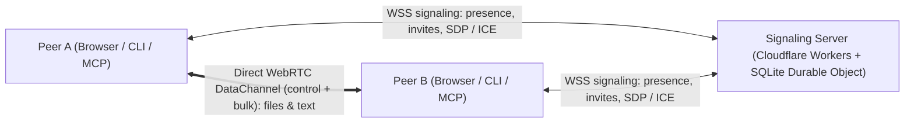

<div align="center">


# One to Ten · 一传十

**Direct cross-platform file, text, and link transfer in the browser — join by QR code, terminal CLI, or AI Agent (MCP)**

[简体中文](./README.md) · **English**

[Live Site](https://1210.ipocket.xyz/en/) · [User Guide](https://1210.ipocket.xyz/en/guide) · [Quick Start](#quick-start) · [Deployment](#deployment) · [CLI & MCP](#cli-and-mcp) · [Architecture & Security](#architecture-and-security)

</div>

---

## Overview

**One to Ten** lets you transfer files, text, and links across iOS, Android, Windows, Linux, and macOS using only a modern web browser — no app installation or account required. Create a room on any device, then scan the QR code or open the invite link from another device to join.

The server (Cloudflare Workers with one SQLite Durable Object per room) **only coordinates rooms, short-lived credentials, and WebRTC signaling**. File names, file payloads, SHA-256 digests, and text messages travel **directly peer-to-peer over WebRTC DataChannels** without passing through a server.

## Key Features

- **No-install cross-platform transfers**: Works in modern browsers on iOS, Android, Windows, Linux, and macOS with up to 8 online devices per room.
- **Privacy & integrity by design**:
  - Invite secrets are placed in the URL fragment (`#invite=...`) and stripped from the address bar immediately upon loading;
  - Direct peer-to-peer only (both server and clients reject TURN relay candidates);
  - A dedicated Web Worker computes incremental SHA-256 hashes and only commits a transfer after every byte is stored and verified.
- **Large-file staging & resumable transfers**:
  - Adapts to browser storage capabilities: File System Access direct save, OPFS staging (up to 512 MiB), LAN HTTP IndexedDB chunked staging (up to 4 GiB), and in-memory staging (32 MiB);
  - Synchronous OPFS and IndexedDB paths persist checkpoints every `1 MiB`, allowing interrupted transfers (or refreshed receiver tabs) to verify the committed prefix and resume.
- **Publish-to-claim sharing & live text**: Attach up to 16 files per batch, publish files for explicit claim-and-approve delivery, or send text and links up to `12 KiB` per message.
- **Native CLI & AI Agent (MCP) support**: Powered by `node-datachannel` over the exact same WebRTC protocol, allowing terminal scripts and local stdio MCP agents (such as Codex) to join a room as a peer and exchange files up to 4 GiB with phones or desktops.
- **12 localized languages**: Built-in support for Simplified Chinese, English, Español, Português (Brasil), Français, Deutsch, 日本語, 한국어, Русский, العربية (with RTL), हिन्दी, and Bahasa Indonesia, with prerendered pages and multilingual SEO.
- **Zero external runtime dependencies**: Self-hosted assets with strict CSP, no external CDN/fonts, no external STUN required by default, and ready to run on a local network over HTTP or HTTPS.

## Quick Start

### Prerequisites

- Node.js `22.23+`, `24.22+`, or `26.12+` (see `engines` in `package.json`)

### Run Locally

The repository includes an npm lockfile and a local Cloudflare Workers runtime, so **no Cloudflare account is required to run locally**:

```sh
git clone https://github.com/iPocket-APP/OneToTen.git
cd OneToTen
npm ci
npm run dev
```

Open `http://127.0.0.1:5173/`, create a room, and open the invite link in a separate browser profile or private window to test two devices with isolated storage and downloads.

> **Note**: Binding to `127.0.0.1` only works on the same computer. To scan the QR code from a phone on the same Wi-Fi network, configure `FILE_ROOM_HOST` as described in [Local Network Deployment](#option-1-local-network-computer-self-hosted-runtime).

## How It Works

1. **Create & join a room**: Create a room on one device and scan the QR code or open the invite link on another. Invites expire after 10 minutes by default; the host can rotate invites, remove devices, or end the room at any time.
2. **Send files & text**: Select an online peer, type text or links, and attach or drag files (up to 16 files at once). Files are sent sequentially and accepted or rejected individually by the recipient.
3. **Receive & export**: The recipient chooses a save option and monitors progress at the top of the room. Once verified and saved, staged files can be downloaded, shared via the OS share sheet (where supported), or removed from **Received files**.
4. **Publish files for claiming**: Selected files can be published to the whole room or a specific peer. Claimants submit a request, and the data channel opens only after the sender approves. Published shares go offline if the source tab closes.
5. **Room lifecycle**: Closing the host's tab only takes that device offline; active transfers between remaining peers continue. Rooms live for 2 hours by default with up to a 10-minute recovery window when empty. Text history stays in memory for the current tab only.

### Save Options & Resume Support

| Save mode | Requirements & limit | Resume support | Completion semantics |
| --- | --- | --- | --- |
| **Direct save** | Secure context (HTTPS / `localhost`) with File System Access save picker | No (resend on failure) | Marked saved once SHA-256 matches and the file writer commits |
| **OPFS staging** | Secure context with writable OPFS, up to **512 MiB** per file | Sync-handle path (`1 MiB` checkpoints) | Verified and committed to **Received files** for download or OS sharing |
| **IndexedDB staging** | Trusted LAN HTTP with browser storage quota, up to **4 GiB** per file | Yes (transactional `1 MiB` checkpoints) | Verified and committed to **Received files** for download; expired partials are pruned |
| **Memory staging** | Compatibility fallback, **32 MiB** total budget per tab | No (resend on failure) | Exportable from the current tab after verification; freed on close |

> To resume an interrupted transfer, keep the original file and sender tab open and trigger resume; the recipient can refresh the same tab to continue with the existing room session. Both sides verify the committed prefix before sending the remaining bytes. Keep mobile browsers in the foreground during large transfers.

## Deployment

This project ships with a local Workers runtime for LAN computers and deploys cleanly to Cloudflare Workers for public hosting.

### Option 1: Local Network Computer (Self-Hosted Runtime)

Copy `.env.example` to `.env.local` and adjust for your network:

```sh
cp .env.example .env.local
```

#### 1) Trusted LAN over Plain HTTP (Zero Certificate Setup)

Add to `.env.local`:

```env
FILE_ROOM_HOST=0.0.0.0   # Listen on all interfaces, or set a fixed LAN IP such as 192.168.1.100
FILE_ROOM_LAN_HTTP=1
```

Build and start the production preview server (or run `npm run dev` for development):

```sh
npm run build
npm run preview          # Defaults to port 4173; override with npm run preview -- --port 8443
```

Open `http://<lan-ip>:4173/` to create a room, then scan the QR code from other devices on the same network.

- `FILE_ROOM_LAN_HTTP=1` is evaluated only at local server runtime when HTTPS and `FILE_ROOM_SITE_URL` are not set — **it is never baked into production bundles**. With `0.0.0.0`, only direct private-network clients accessing local IPs or `.local` hosts are allowed, and proxied requests are rejected.
- Plain HTTP pages and signaling are unencrypted; browsers disable direct save pickers and OPFS and automatically fall back to resumable IndexedDB staging (up to 4 GiB).

#### 2) LAN over HTTPS (Recommended for Full Browser Features)

Provide a TLS certificate trusted by participating devices (for example, issued via a local `mkcert` CA) covering the LAN IP or hostname:

```env
FILE_ROOM_HOST=192.168.1.100
FILE_ROOM_TLS_CERT=/absolute/path/to/cert.pem
FILE_ROOM_TLS_KEY=/absolute/path/to/key.pem
```

Run `npm run build && npm run preview` (or `npm run dev`) to unlock the native save file picker, OPFS, and one-click clipboard copy.

#### 3) Behind a Reverse Proxy (Caddy / Nginx)

If a reverse proxy terminates HTTPS and forwards traffic to `127.0.0.1:4173`, forward `Host`, `X-Forwarded-Proto: https`, and WebSocket upgrade headers, and set `FILE_ROOM_SITE_URL=https://your-domain` in `.env.local` so the external hostname is permitted by Vite's host check.

### Option 2: Deploy to Cloudflare Workers

1. Update `name` and `siteHostname` in [cloudflare.config.ts](./cloudflare.config.ts) for your own domain (or remove `domains` to deploy to `*.workers.dev`).
2. Optionally set `FILE_ROOM_SITE_URL=https://your-domain` in `.env.production.local` to customize canonical URLs, Open Graph metadata, and `/sitemap.xml`.
3. Authenticate with Cloudflare via `cf` and deploy:

```sh
npm run build
npm run deploy
```

> Run `npm run build -- --mode test` to produce a `noindex` build for staging or private previews. Production builds generate `/sitemap.xml` covering home and guide pages across all 12 locales while marking invite and room pages `noindex, nofollow`.

### Environment Variables

| Variable | Description | Default |
| --- | --- | --- |
| `FILE_ROOM_HOST` | Bind address for local `dev` and `preview` servers (fixed IP, hostname, or `0.0.0.0` / `::`) | `127.0.0.1` |
| `FILE_ROOM_LAN_HTTP` | Set to `1` to allow plain HTTP on a trusted LAN in local `dev` / `preview` (ignored with HTTPS or `FILE_ROOM_SITE_URL`) | Disabled |
| `FILE_ROOM_TLS_CERT` | Absolute path to TLS certificate file (must be paired with `FILE_ROOM_TLS_KEY`) | None |
| `FILE_ROOM_TLS_KEY` | Absolute path to TLS private key file (must be paired with `FILE_ROOM_TLS_CERT`) | None |
| `FILE_ROOM_SITE_URL` | Override public HTTPS origin for builds, or allow a reverse-proxy hostname locally | `cloudflare.config.ts` in production builds |
| `FILE_ROOM_LOCAL_FINDER` | macOS dev-only; set to `1` to enable "Save and reveal in Finder" (saves to `~/Downloads`) for the local browser | Disabled |
| `VITE_ROOM_STUN_URL` | Optional `stun:` server URL (e.g. `stun:stun.example.com:3478`) for reflexive ICE candidates | Empty (host candidates only) |
| `FILE_ROOM_SERVER` | Default server origin for the CLI (same as `--server`) | None |
| `FILE_ROOM_INVITE` | Default invite URL for the CLI (same as `--invite`) | None |
| `FILE_ROOM_STUN_URL` | Default STUN URL for CLI / MCP (same as `--stun`) | None |
| `FILE_ROOM_TEST_URL` | Target server URL for Playwright end-to-end tests | `http://127.0.0.1:5173` |

## CLI and MCP

The CLI and MCP server join a room as a regular peer over the same WebRTC DataChannel protocol, allowing terminals and AI agents to transfer files directly with browser clients (up to 4 GiB per file, one file at a time; resend if interrupted).

Build the CLI / MCP entry point first:

```sh
npm ci
npm run build:agent
```

Invoke via `npm run cli -- ...`, or run `npm link` in the repository root to use `file-room` globally.

### CLI Usage

**1) Join an existing room and send a file**

Store the full invite URL from the browser in `FILE_ROOM_INVITE` (or pass `--invite URL`):

```sh
export FILE_ROOM_INVITE='https://1210.ipocket.xyz/join/...'
npm run cli -- peers
npm run cli -- send --to 'iPhone' ./report.pdf
```

Device names must match exactly; if multiple peers share a name, pass the peer ID returned by `peers`. You can also host a room directly from the CLI and wait for the recipient to join:

```sh
npm run cli -- send --server https://1210.ipocket.xyz --to 'iPhone' ./report.pdf
```

**2) Host a room and receive a file in the terminal**

```sh
npm run cli -- receive --server http://127.0.0.1:5173 --out ./inbox
```

Open the printed invite link on another device, select **File Room CLI**, send the file, and confirm in the terminal.

- Default inbox directory: `~/Downloads/One to Ten` (name collisions are automatically numbered).
- Useful flags: `--accept` (non-interactive single-file accept), `--from PEER_ID` (restrict sender), `--name NAME` (custom device label), `--timeout SECONDS` (1–7200, default 300), `--allow-http` (trusted LAN HTTP), `--stun stun:host:port`, and `--json` (newline-delimited JSON output, e.g. `npm run --silent cli -- ... --json`).

### MCP Usage (AI Agent Integration)

The MCP server runs over local `stdio`. Below is an example registering it with Codex (replace `--server` with an origin reachable by your phone; append `--allow-http` for trusted LAN HTTP):

```sh
mkdir -p inbox outbox
codex mcp add file-room -- "$(command -v node)" "$PWD/dist-agent/agent/cli.js" mcp \
  --server https://1210.ipocket.xyz --inbox "$PWD/inbox" --send-dir "$PWD/outbox"
```

Any MCP client supporting local `stdio` can launch the same Node entry point and arguments.

- **Security boundaries**: MCP accepts invites only from the configured `--server` origin; outbound paths are strictly confined to `--send-dir` (omit `--send-dir` for receive-only mode); saved files return their absolute local path and verified SHA-256 digest.
- **Available tools**:

| Tool | Purpose |
| --- | --- |
| `file_room_create` | Create a room on the configured server and return its invite URL |
| `file_room_join` | Join an existing room with a user-supplied invite link |
| `file_room_status` | List online peers, pending incoming offers, and recent transfers |
| `file_room_send` | Offer up to 16 files from `--send-dir` to a specific online peer |
| `file_room_accept` | Accept a pending offer and save the verified file into `--inbox` |
| `file_room_reject` | Decline a pending file offer |
| `file_room_cancel` | Cancel a queued or active transfer |
| `file_room_wait` | Wait briefly for a new incoming offer or for a transfer to finish |
| `file_room_rotate_invite` | Generate a fresh invite and invalidate the previous link (host only) |
| `file_room_leave` | Leave the room and stop active transfers |

## Architecture and Security



### Technical Details

- **Frontend & static pages**: React 19, TypeScript, Vite 8, and a custom static prerendering plugin ([dev/public-pages.tsx](./dev/public-pages.tsx)) generating localized home/guide pages, metadata, `robots.txt`, and `sitemap.xml` for all 12 locales.
- **Signaling & isolation**: Each room runs in its own SQLite Durable Object ([src/worker/index.ts](./src/worker/index.ts)) using Cloudflare's WebSocket Hibernation API and Alarms for cleanup, enforcing same-origin checks, Bearer/subprotocol session tokens, payload bounds, and rate limits.
- **Transfer protocol**:
  - Peers establish on-demand connections with reliable, ordered `control` (JSON) and `bulk` (binary frames with a 48-byte fixed header supporting 64-bit offsets) DataChannels;
  - Frames are capped at `16 KiB` (shrinking dynamically to negotiated SCTP limits), with `1 MiB` high-water / `256 KiB` low-water send buffering and a `4 MiB` receive credit window;
  - A Dedicated Worker ([src/browser/file-worker.ts](./src/browser/file-worker.ts)) handles incremental SHA-256 hashing and storage commits, emitting `file.commit` only after full byte verification and persistence succeed.
- **Security headers**: [public/_headers](./public/_headers) enforces a strict CSP (`default-src 'none'`, self-only scripts/styles/connections/workers), `Referrer-Policy: no-referrer`, and `frame-ancestors 'none'`.

### Repository Structure

```text
.
├── cloudflare.config.ts     # Cloudflare Workers, Assets, Durable Object, and rate-limit config
├── vite.config.ts           # Vite dev, build, and LAN preview configuration
├── dev/
│   ├── public-pages.tsx     # Multilingual prerendering, metadata, and sitemap plugin
│   ├── lan-http.ts          # Local runtime LAN HTTP verification middleware
│   └── local-finder.ts      # macOS dev-only "Save and reveal in Finder" middleware
├── public/                  # Brand assets, _headers, and _redirects
├── src/
│   ├── shared/room.ts       # Shared protocol constants, types, and validation
│   ├── worker/index.ts      # Cloudflare Worker router and Room Durable Object
│   ├── browser/             # Web app, WebRTC pairing, transfer engine, storage worker, 12 locales
│   └── agent/               # CLI, MCP server, and local disk storage adapter
└── tests/                   # Unit tests and Playwright end-to-end tests
```

## Development & Verification

```sh
# Type-check browser, worker, tooling, and agent targets
npm run typecheck

# Run unit tests (protocol, locales, LAN HTTP, local Finder)
npm test

# Install Playwright browsers and run end-to-end tests
PLAYWRIGHT_SKIP_BROWSER_GC=1 npm exec playwright install chromium webkit
npm run test:e2e
```

Targeted test runs:

```sh
# CLI & MCP suite (real stdio, Chromium & WebKit bidirectional transfers, directory bounds)
npm run test:e2e -- tests/agent.spec.ts

# Run end-to-end tests against a local production preview or LAN HTTP server
FILE_ROOM_TEST_URL=http://127.0.0.1:4173 npm run test:e2e
FILE_ROOM_TEST_URL=http://192.168.1.100:4173 npm run test:e2e -- --grep 'LAN HTTP'
```

## Limitations & Roadmap

- **Direct connectivity required**: Only direct WebRTC connections are currently enabled (no TURN relay). Devices on isolated guest Wi-Fi or behind restrictive symmetric NATs/firewalls may fail to connect; connect both devices to the same local network or configure STUN via `VITE_ROOM_STUN_URL` / `--stun`.
- **Mobile backgrounding**: Mobile OSes may suspend WebRTC sockets and storage writes when a browser tab moves to the background. Keep the page in the foreground while transferring large files.
- **Planned directions**: Standalone Node.js / Docker self-hosted server (independent of the Cloudflare runtime), optional TURN relay support, and offline initial pairing.

## Contributing

Issues and pull requests are welcome:

1. Fork the repository and create a feature branch.
2. Ensure `npm run typecheck`, `npm test`, and relevant `npm run test:e2e` suites pass before submitting.
3. If you add or change UI strings, update all 12 locale catalogs under `src/browser/locales/` (`tests/locales.test.ts` enforces full key and interpolation parity).

## License

This project is licensed under the [MIT License](./LICENSE).
