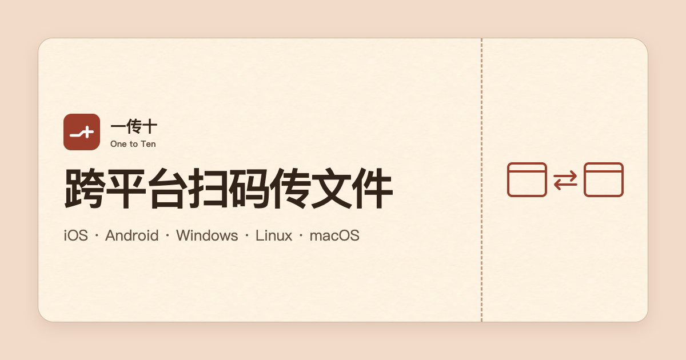
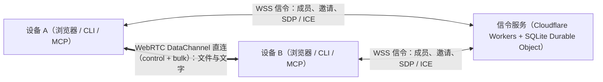

<div align="center">


# 一传十 · One to Ten

**跨平台浏览器直连传文件、文字与链接 —— 扫码即连，也支持终端 CLI 与 AI Agent（MCP）**

**简体中文** · [English](./README.en.md)

[在线体验](https://1210.ipocket.xyz/) · [使用指南](https://1210.ipocket.xyz/guide) · [快速开始](#快速开始) · [局域网与公网部署](#部署方式) · [CLI 与 MCP](#cli-与-mcp) · [架构与安全](#架构与安全)

<br />



</div>

---

## 简介

**一传十（One to Ten）** 是一款无需安装客户端的跨平台传输工具，适用于 iOS、Android、Windows、Linux 和 macOS。在任意设备的浏览器中创建房间，其他设备扫码或打开邀请链接即可加入，直接互传文件、文字与链接。

服务端（Cloudflare Workers + 每房间一个 SQLite Durable Object）**仅负责房间管理、短期凭证与 WebRTC 信令交换**；所有文件名、正文数据、SHA-256 校验摘要与文字内容均通过设备间的 **WebRTC DataChannel 点对点直连传输**，不经过服务器中转。

## 核心特性

- **零安装、跨平台直连**：覆盖 iOS、Android、Windows、Linux、macOS 现代浏览器，同一房间最多支持 8 台设备同时在线。
- **隐私与完整性保障**：
  - 邀请密钥位于 URL fragment（`#invite=...`），页面读取后立即从地址栏清除；
  - 仅启用点对点直连（服务端与客户端均拒绝 TURN 中继候选）；
  - Dedicated Web Worker 增量计算 SHA-256，接收端全部字节落盘并校验一致后才确认完成。
- **大文件暂存与断点续传**：
  - 自动适配浏览器能力：支持系统文件保存选择器（直接保存）、OPFS 暂存（最高 512 MiB）、局域网 HTTP IndexedDB 分块暂存（最高 4 GiB）及内存暂存（32 MiB）；
  - OPFS 同步写入与 IndexedDB 路径每 `1 MiB` 提交持久化检查点，连接断开或接收端刷新后可校验前缀并续传。
- **待领取分享与实时文字**：支持批量附带最多 16 个文件、发布「待领取分享」（领取端申请、发送端审批后开启传输），以及单条上限 `12 KiB` 的即时文字与链接传输。
- **原生终端 CLI 与 AI Agent（MCP）**：通过 `node-datachannel` 沿用同一套 WebRTC 协议，电脑终端脚本或支持本地 stdio MCP 的 AI Agent（如 Codex 等）可直接作为房间内的一台设备与手机互传文件（单文件上限 4 GiB）。
- **12 种语言界面**：内置简体中文、English、Español、Português (Brasil)、Français、Deutsch、日本語、한국어、Русский、العربية（含 RTL）、हिन्दी、Bahasa Indonesia，支持静态预渲染与多语言 SEO。
- **零外部依赖，可纯局域网运行**：无外链 CDN/字体，默认不依赖外部 STUN，支持在局域网电脑上以 HTTP 或 HTTPS 本地部署。

## 快速开始

### 环境要求

- Node.js `22.23+`、`24.22+` 或 `26.12+`（见 `package.json` 中的 `engines`）

### 本地开发运行

项目自带 npm 锁文件与本地 Cloudflare Workers 运行时，**无需登录 Cloudflare 账号即可启动**：

```sh
git clone https://github.com/iPocket-APP/OneToTen.git
cd OneToTen
npm ci
npm run dev
```

打开 `http://127.0.0.1:5173/` 创建房间并复制邀请链接，在另一个独立浏览器配置或隐私窗口中打开链接即可测试双端互传（使用独立配置可分开各自的下载与站点存储）。

> **提示**：仅监听 `127.0.0.1` 时，二维码只适用于本机。如需手机扫码加入，请参考下方「[局域网部署](#方式一局域网电脑部署本地运行)」配置 `FILE_ROOM_HOST`。

## 使用方式

1. **创建与加入房间**：任一设备创建房间后，其他设备扫码或打开邀请链接加入。邀请默认有效 10 分钟，创建者可随时轮换邀请、移出设备或结束房间。
2. **发送文件与文字**：选择在线设备，输入文字、粘贴链接或拖入/添加附件（单次最多 16 个文件），也可同时发送文字和文件。文件逐个发送，接收方逐个同意或拒绝。
3. **接收与导出**：接收端选择保存方式并在页面上方查看进度。校验并提交成功后，可从右上角通知或「接收的文件」下载、调用系统分享或移除暂存副本。
4. **待领取分享**：选中文件后可发布为待领取分享（可面向全房或指定设备）；对方发起领取申请、发送端确认后才会打开文件通道。发送页离开后，分享自动下线。
5. **会话生命周期**：关闭创建者标签页仅使该设备离线，其他在线设备之间已建立的传输可继续。房间默认存活 2 小时，全员离线后的恢复窗口最多 10 分钟；文字记录仅保存在当前页面内存，刷新即清空。

### 保存方式与续传能力

| 保存方式 | 适用条件与上限 | 断点续传 | 完成语义 |
| --- | --- | --- | --- |
| **直接保存** | 安全上下文（HTTPS / `localhost`）且浏览器支持系统保存选择器 | 不支持（可重发） | SHA-256 校验一致并提交写入后显示「已保存到所选位置」 |
| **OPFS 暂存** | 安全上下文且浏览器 OPFS 可写，单文件上限 **512 MiB** | 同步写入路径支持（每 `1 MiB` 检查点） | 校验并提交后可从「接收的文件」下载或系统分享 |
| **IndexedDB 暂存** | 局域网 HTTP 且浏览器可写配额，单文件上限 **4 GiB** | 支持（每 `1 MiB` 事务提交检查点） | 校验并提交后从「接收的文件」下载；过期未完成文件自动清理 |
| **内存暂存** | 小文件兼容路径，当前页面总预算 **32 MiB** | 不支持（可重发） | 校验后可从当前页面导出，关闭页面后释放 |

> 断线续传时，发送方需保留原页面与原文件并发起续传，接收方重新确认（接收方可刷新同一标签页沿用原会话）。两端会重新校验已提交前缀，并从确认的检查点继续传输。手机传输大文件时请保持页面在前台。

## 部署方式

项目内置本地 Workers 运行时，支持局域网电脑本地运行，也支持一键发布到 Cloudflare Workers。

### 方式一：局域网电脑部署（本地运行）

复制 `.env.example` 为 `.env.local` 并按需配置：

```sh
cp .env.example .env.local
```

#### 1) 可信局域网明文 HTTP（零证书，开箱即用）

在 `.env.local` 中配置：

```env
FILE_ROOM_HOST=0.0.0.0   # 监听全部网卡；也可指定固定局域网 IP，如 192.168.1.100
FILE_ROOM_LAN_HTTP=1
```

构建并启动生产预览（或直接 `npm run dev` 启动开发服务）：

```sh
npm run build
npm run preview          # 默认 4173 端口；可用 npm run preview -- --port 8443 自定义端口
```

使用 `http://<电脑局域网IP>:4173/` 创建房间，局域网内其他设备扫码即可加入。

- `FILE_ROOM_LAN_HTTP=1` 仅在未配置 HTTPS 和 `FILE_ROOM_SITE_URL` 时于本地服务运行时生效，**不会写入构建产物**；使用 `0.0.0.0` 时仅放行私网直连客户端与本机地址/`.local` 域名，并自动拒绝反向代理请求。
- 明文 HTTP 下页面与信令未加密，浏览器会禁用直接保存选择器和 OPFS，自动切至 IndexedDB 分块暂存（上限 4 GiB，支持续传）。

#### 2) 局域网 HTTPS（推荐长期使用，功能完整）

准备一张包含局域网 IP 或内网域名、且被所有参与设备信任的证书（例如使用 `mkcert` 自建本地 CA），在 `.env.local` 中配置：

```env
FILE_ROOM_HOST=192.168.1.100
FILE_ROOM_TLS_CERT=/绝对路径/cert.pem
FILE_ROOM_TLS_KEY=/绝对路径/key.pem
```

运行 `npm run build && npm run preview`（或 `npm run dev`），即可启用完整的直接保存选择器、OPFS 和剪贴板复制。

#### 3) 前置反向代理（Caddy / Nginx 等）

若由反向代理终结 HTTPS 并转发至本机 `127.0.0.1:4173`，请确保代理正确透传 `Host`、`X-Forwarded-Proto: https` 与 WebSocket 升级头，并在 `.env.local` 中配置 `FILE_ROOM_SITE_URL=https://你的域名` 以将其加入允许的 Host 列表。

### 方式二：部署到 Cloudflare Workers

1. 根据你的域名修改 [cloudflare.config.ts](./cloudflare.config.ts) 中的 `name` 与 `siteHostname`（如仅使用 `*.workers.dev`，可移除自定义 `domains`）。
2. 如需覆盖公开 HTTPS 根地址（用于 canonical、Open Graph 元数据与 `/sitemap.xml`），在 `.env.production.local` 设置 `FILE_ROOM_SITE_URL=https://你的域名`。
3. 确认已通过 `cf` 完成 Cloudflare 账号登录与权限配置后执行：

```sh
npm run build
npm run deploy
```

> 使用 `npm run build -- --mode test` 可生成带 `noindex` 的本地构建包，避免测试环境被搜索引擎收录。公开站点上线后可在 Google Search Console 提交 `/sitemap.xml`（包含全部 12 种语言的首页和使用指南；邀请与房间页默认通过响应头和 `<meta name="robots">` 禁止索引）。

### 环境变量参考

| 变量 | 说明 | 默认值 |
| --- | --- | --- |
| `FILE_ROOM_HOST` | 本地 `dev` / `preview` 监听地址，支持固定 IP、主机名或 `0.0.0.0` / `::` | `127.0.0.1` |
| `FILE_ROOM_LAN_HTTP` | 设为 `1` 允许本地服务在可信局域网使用 HTTP（配 HTTPS 或 `FILE_ROOM_SITE_URL` 时自动忽略） | 未启用 |
| `FILE_ROOM_TLS_CERT` | 本地 HTTPS 证书文件的绝对路径（须与 `FILE_ROOM_TLS_KEY` 成对配置） | 无 |
| `FILE_ROOM_TLS_KEY` | 本地 HTTPS 私钥文件的绝对路径（须与 `FILE_ROOM_TLS_CERT` 成对配置） | 无 |
| `FILE_ROOM_SITE_URL` | 覆盖构建时的公开 HTTPS 根地址，或为本地反向代理提供允许的外部域名 | 生产构建默认取 `cloudflare.config.ts` |
| `FILE_ROOM_LOCAL_FINDER` | 仅 macOS 开发模式有效；设为 `1` 后，本机浏览器支持「保存并在 Finder 中显示」（保存到 `~/Downloads`） | 未启用 |
| `VITE_ROOM_STUN_URL` | 可选 `stun:` 服务器地址（如 `stun:stun.example.com:3478`），用于生成反射候选 | 空（仅本机候选） |
| `FILE_ROOM_SERVER` | CLI 默认房间服务端地址（等价于 `--server`） | 无 |
| `FILE_ROOM_INVITE` | CLI 默认邀请链接（等价于 `--invite`） | 无 |
| `FILE_ROOM_STUN_URL` | CLI / MCP 默认 STUN 地址（等价于 `--stun`） | 无 |
| `FILE_ROOM_TEST_URL` | Playwright 端到端测试的目标站点地址 | `http://127.0.0.1:5173` |

## CLI 与 MCP

CLI 与 MCP 客户端将电脑终端或 AI Agent 作为一台普通设备接入房间，复用同一套 WebRTC DataChannel 协议，与手机或电脑网页直接互传文件（单文件上限 4 GiB，每次处理一份，中断后可重新发送）。

先构建 Agent / CLI 入口：

```sh
npm ci
npm run build:agent
```

构建后可通过 `npm run cli -- ...` 调用；如需在任意目录直接使用 `file-room` 命令，可在项目根目录执行 `npm link`。

### CLI 用法

**1) 加入已有房间并发送文件**

从网页复制完整邀请链接，存入 `FILE_ROOM_INVITE`（或通过 `--invite URL` 传入）：

```sh
export FILE_ROOM_INVITE='https://1210.ipocket.xyz/join/...'
npm run cli -- peers
npm run cli -- send --to 'iPhone' ./report.pdf
```

设备名需精确匹配；若存在同名设备，改传 `peers` 返回的设备 ID。也可以直接由 CLI 建房并等待目标设备加入：

```sh
npm run cli -- send --server https://1210.ipocket.xyz --to 'iPhone' ./report.pdf
```

**2) 在终端建房并接收文件**

```sh
npm run cli -- receive --server http://127.0.0.1:5173 --out ./inbox
```

在手机或另一台设备打开终端输出的邀请链接，选择「File Room CLI」发送文件，随后在终端确认接收。

- 默认接收目录为 `~/Downloads/One to Ten`，同名文件自动编号。
- 常用参数：`--accept`（非交互自动接收一份文件）、`--from PEER_ID`（限定发送设备）、`--name NAME`（自定义设备名）、`--timeout SECONDS`（1–7200 秒，默认 300）、`--allow-http`（可信局域网 HTTP 调试）、`--stun stun:host:port`、`--json`（逐行 JSON 输出，便于脚本集成，可配合 `npm run --silent cli -- ... --json`）。

### MCP 用法（AI Agent 集成）

MCP 通过本地 `stdio` 运行，由支持 MCP 的 Agent 客户端拉起子进程并保持在线。下面以 Codex 为例（跨设备使用时，将 `--server` 替换为手机也能访问的地址；局域网 HTTP 需追加 `--allow-http`）：

```sh
mkdir -p inbox outbox
codex mcp add file-room -- "$(command -v node)" "$PWD/dist-agent/agent/cli.js" mcp \
  --server https://1210.ipocket.xyz --inbox "$PWD/inbox" --send-dir "$PWD/outbox"
```

其他支持本地 stdio 的 MCP 客户端使用相同的 Node 命令与参数即可。

- **安全边界**：MCP 仅接受配置站点（`--server`）生成的邀请；发送路径严格限定在 `--send-dir` 目录内（省略 `--send-dir` 则仅开启接收模式）；已接收文件落盘后返回本机绝对路径与 SHA-256。
- **可用工具**：

| 工具名 | 作用 |
| --- | --- |
| `file_room_create` | 在配置站点创建房间并返回邀请链接 |
| `file_room_join` | 使用用户提供的邀请链接加入房间 |
| `file_room_status` | 查看当前房间状态、在线设备、待确认文件和近期传输记录 |
| `file_room_send` | 向指定在线设备发送 `--send-dir` 内的文件（最多 16 个） |
| `file_room_accept` | 接受待收文件并保存到 `--inbox` |
| `file_room_reject` | 拒绝待收文件 |
| `file_room_cancel` | 取消排队中或进行中的传输 |
| `file_room_wait` | 短时等待新的待收请求或指定传输完成 |
| `file_room_rotate_invite` | 轮换当前房间邀请链接并使旧链接失效（仅房主可用） |
| `file_room_leave` | 离开当前房间并中止活跃传输 |

## 架构与安全



### 技术细节

- **前端与静态页**：React 19、TypeScript、Vite 8 与自定义静态预渲染插件（[dev/public-pages.tsx](./dev/public-pages.tsx)），生成 12 种语言的首页、使用指南、`robots.txt` 与 `sitemap.xml`。
- **信令与房间隔离**：每个房间对应独立的 SQLite Durable Object（[src/worker/index.ts](./src/worker/index.ts)），使用 Cloudflare WebSocket Hibernation API 与 Alarm 过期清理；校验同源 `Origin`、Bearer / 子协议会话令牌、消息大小、格式与速率限制。
- **传输协议**：
  - 每对设备按需建立连接，开启可靠有序的 `control`（JSON 控制消息）与 `bulk`（二进制数据帧，48 字节定长帧头，支持 64 位偏移量）两个通道；
  - 完整帧上限 `16 KiB`（按 SCTP 协商值动态收敛），发送队列高水位 `1 MiB` / 低水位 `256 KiB`，接收信用窗口 `4 MiB`；
  - Dedicated Worker（[src/browser/file-worker.ts](./src/browser/file-worker.ts)）负责增量 SHA-256 与分块落盘，仅在所有字节齐全、摘要一致且存储提交成功后回传 `file.commit`。
- **安全响应头**：[public/_headers](./public/_headers) 配置严格 CSP（`default-src 'none'`，脚本/样式/连接/Worker 全部限定 `'self'`）、`Referrer-Policy: no-referrer` 与 `frame-ancestors 'none'`。

### 项目结构

```text
.
├── cloudflare.config.ts     # Cloudflare Workers、Assets、Durable Object 与限流配置
├── vite.config.ts           # Vite 开发/构建/局域网预览配置
├── dev/
│   ├── public-pages.tsx     # 多语言静态页面预渲染、meta 与 sitemap 生成
│   ├── lan-http.ts          # 本地运行时局域网 HTTP 校验中间件
│   └── local-finder.ts      # macOS 本地开发「保存并在 Finder 中显示」中间件
├── public/                  # 图标、分享图、_headers 与 _redirects
├── src/
│   ├── shared/room.ts       # 跨端共享的协议常量、类型与校验规则
│   ├── worker/index.ts      # Cloudflare Worker 路由与 Room Durable Object
│   ├── browser/             # Web 应用、WebRTC 配对、传输状态机、Worker 存储与 12 语言包
│   └── agent/               # CLI、MCP 服务器与本地磁盘存储实现
└── tests/                   # 单元测试与 Playwright 端到端测试
```

## 开发与验证

```sh
# 类型检查（浏览器、Worker、工具脚本与 Agent）
npm run typecheck

# 单元测试（协议、多语言、LAN HTTP、本地 Finder 等）
npm test

# 安装 Playwright 浏览器并运行端到端测试
PLAYWRIGHT_SKIP_BROWSER_GC=1 npm exec playwright install chromium webkit
npm run test:e2e
```

专项验证命令：

```sh
# 仅验证 CLI 与 MCP（含真实 stdio、Chromium & WebKit 双向流、目录边界等）
npm run test:e2e -- tests/agent.spec.ts

# 针对本地生产预览或局域网 HTTP 地址运行端到端测试
FILE_ROOM_TEST_URL=http://127.0.0.1:4173 npm run test:e2e
FILE_ROOM_TEST_URL=http://192.168.1.100:4173 npm run test:e2e -- --grep 'LAN HTTP'
```

## 已知边界与规划

- **网络连通性**：当前仅支持 WebRTC 直连（不提供 TURN 中继）。如两台设备位于隔离的访客 Wi-Fi、严格对称 NAT 或防火墙后，可能无法建立连接；建议处于同一局域网，或通过 `VITE_ROOM_STUN_URL` / `--stun` 配置 STUN。
- **移动端后台限制**：浏览器切到后台或锁屏后，系统可能挂起 WebRTC 连接与存储写入，手机传大文件时请保持页面在前台。
- **后续方向**：独立纯 Node.js / Docker 自托管服务端（不依赖 Cloudflare 运行时）、可选 TURN 中继与离线首次配对体验。

## 参与贡献

欢迎提交 Issue 与 Pull Request：

1. Fork 本仓库并从主分支创建特性分支。
2. 改动完成后确保 `npm run typecheck`、`npm test`（以及相关 `npm run test:e2e`）全部通过。
3. 如新增或修改了界面文案，请同步更新 `src/browser/locales/` 下所有 12 个语言目录（`tests/locales.test.ts` 会校验所有键与插值占位符一致）。

## 开源协议

本项目基于 [MIT License](./LICENSE) 开源。
